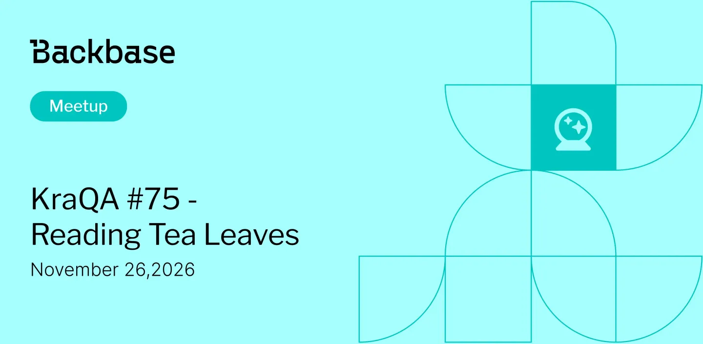

# KraQA#75: What will the world of testing look like in 2027?

Event date: November 26, 2026 | Backbase office | KraQA | Testing | QA

Authors: Backbase Meetups
Date: 2026-11-19T12:30:00.000Z  
Category: meetups

tags: krakow, meetup, kraqa, testing, qa, ai

Location: Krakow
 
--- 

We invite you to a unique meeting during which, together with KraQA, we will try to look into the future and answer the question: what will the IT market and testing scene look like in 2027?

[Get your ticket](https://www.meetup.com/kraqa-pl/events/317395929/?slug=kraqa-pl&eventId=317395929)

Together with the Experts, we will consider:

- which testing competencies will gain in importance and which will lose their importance,
- How AI agents and LLMs are changing the daily work of testers and can we trust the tests they write?
- how the structure of QA teams and cooperation with developers can change,
- what technologies and tools are worth learning today,
- Will AI agents take over testers' jobs, or will testers have to manage the chaos that optimistic vibe coding leaves behind?

Bring your own predictions and questions. There will be time for discussion with the experts and the audience!

Event date: 26 November, 2026

Time: 18:00

Location: Backbase Office, High 5ive Four, Pawia 21, 31-154 Krakow

## Experts

### Piotr Wicherski

He has been active in the mobile industry since 2008. He has tested everything mobile: devices, applications, operating systems, modules, robots, headphones… In short: he enjoys mobile QA. He gained experience at companies such as UEFA, T-Mobile, Samsung R&D, Allegro, Applause, Bragi, and Netguru. He is the co-author (vice-chair) of the ISTQB Mobile Application Testing syllabus and administers the largest local online testing community, the Software Testing group. Outside of his professional career, he actively supports organizations and initiatives that promote knowledge and best practices in software quality. He is a member of the Harvard Business Review Advisory Council, the Information Systems Quality Association, the App Quality Alliance, and the Polish Quality Retreat.

### Daniel Dec

He leaves organizations in better shape than he found them. For years, he has been involved in QA and software engineering, broadly defined, helping companies build a culture of quality and efficient production. He knows how to challenge the status quo and initiate transformations, a skill he honed over several years in consulting. For the past two years, he has been an Engineering Manager in R&D at a defense company, where he has built a QA team and is responsible for C2 (command and control) systems for unmanned aerial vehicles. He is a speaker at numerous conferences. Outside of work, he is a Gallup strategist, futurist, DJ, blogger, and chess and football enthusiast.

### Daniel Kulaga

A Senior QA Engineer with 6 years of IT experience, he also previously served as a QA Lead and Product Owner. He currently focuses on AI/ML Quality Assurance: testing strategies for machine learning models, LLM-based systems, and automation. For the past three years, he has been the Conference Program Manager at Test Dive, the largest free QA conference in Poland. In his free time, he plays tennis and soccer and strives to help startups finally start making money.

### Sławek Radzymiński

Senior Staff Test Engineer with over 13 years of experience in test automation and CI/CD. He works daily with AI agents and verifies the trustworthiness of their code and the tests they write. He conducts training courses and workshops (testerzy.pl, TestWarez, AI Testing Conf) and is one of the authors of the AI_Testers program. Since 2015, he has been writing the Awesome Testing blog (https://awesome-testing.com).

[Get your ticket](https://www.meetup.com/kraqa-pl/events/317395929/?slug=kraqa-pl&eventId=317395929)
